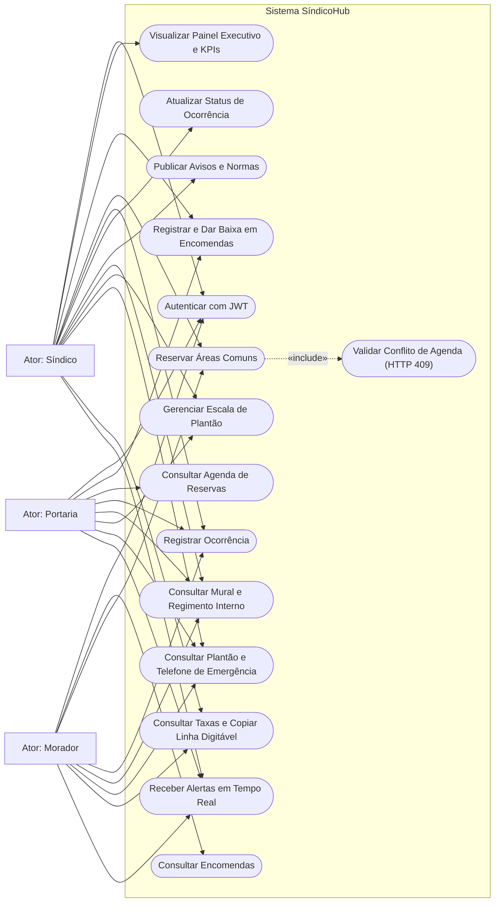
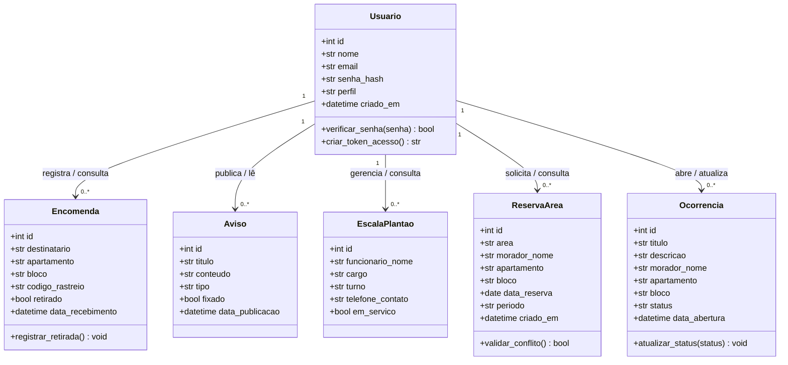

# SíndicoHub

Plataforma web para gestão operacional e administrativa de condomínios residenciais, desenvolvida com arquitetura desacoplada em **React (Vite)**, **FastAPI** e **PostgreSQL**.

O sistema centraliza a rotina de portaria, reservas de áreas comuns com validação anti-conflito, gestão de ocorrências, comunicados oficiais, regimento interno, escala de plantão com contato de emergência e indicadores executivos por perfil de acesso.

---

## Principais Funcionalidades

### Operação de Portaria e Convivência
- **Controle de Encomendas:** registro de pacotes com código de rastreio, busca por destinatário/unidade, filtro por status e baixa imediata de retirada.
- **Escala de Plantão e Emergência:** indicador persistente na barra superior com o funcionário em turno, cargo, horário e telefone/ramal de emergência com cópia em um clique, além de painel dedicado para gestão de escalas.
- **Reservas de Áreas Comuns:** catálogo de espaços (Salão de Festas, Churrasqueiras A e B, Espaço Gourmet e Quadra Esportiva), calendário mensal de disponibilidade e validação anti-conflito no servidor (`HTTP 409`) por área, data e período.
- **Ocorrências e Chamados:** abertura de relatos por unidade e acompanhamento completo com fluxo de transição de status (`Aberto`, `Em análise`, `Resolvido`).
- **Mural de Avisos e Regimento Interno:** feed editorial de comunicados com priorização de avisos fixados e data de publicação, aliado a um guia normativo navegável por capítulos.
- **Taxas e Boletos:** visualização de competências mensais, cópia da linha digitável e emissão de demonstrativo *(atualmente em modo demonstrativo no frontend)*.

### Governança, Segurança e Visão Executiva
- **Autenticação JWT e RBAC no Servidor e Cliente:** login com hashing Bcrypt + emissão de token **JWT (HS256)** validado nas rotas da API por perfil (**Síndico**, **Portaria** e **Morador**), além de rotas protegidas e página inicial contextual no frontend.
- **Painel Executivo:** consolidado de métricas operacionais (encomendas pendentes, reservas agendadas, ocorrências abertas e índice de resolução) com gráficos de distribuição por status e ocupação de áreas.
- **Central de Alertas:** monitoramento periódico em segundo plano para novas encomendas, reservas confirmadas e atualizações de ocorrências, acompanhado por notificações *toast* na interface.
- **Tratamento Padronizado de Exceções:** handlers globais na API para respostas JSON consistentes em erros de validação (`422`), conflito (`409`), autenticação (`401`), permissão (`403`), não encontrado (`404`) e falhas internas (`500`).

---

## Matriz de Perfis de Acesso

| Perfil | Rota Inicial | Escopo Principal |
| --- | --- | --- |
| **Síndico** (`sindico`) | `/painel` | Painel executivo, gestão completa de encomendas, publicação de comunicados e normas, atualização de status de ocorrências, gestão de plantão, reservas e taxas. |
| **Portaria** (`porteiro`) | `/encomendas` | Recebimento e baixa de encomendas, cadastro de escala de plantão, consulta à agenda de reservas, abertura de ocorrências e leitura de mural/regimento. |
| **Morador** (`morador`) | `/reservas` | Agendamento de áreas comuns, consulta de encomendas da unidade, abertura e acompanhamento de ocorrências, taxas/boletos, mural e regimento interno. |

---

## Stack Tecnológica

| Camada | Tecnologias |
| --- | --- |
| **Frontend** | React 19, Vite 8, React Router, Axios, Lucide Icons, CSS modular com design tokens |
| **Backend** | Python 3.11+, FastAPI, SQLAlchemy ORM, Pydantic v2, Bcrypt, PyJWT, Uvicorn |
| **Banco de Dados** | PostgreSQL 15 containerizado via Docker Compose |
| **Infra & Qualidade** | Docker (Nginx + Uvicorn + PostgreSQL), GitHub Actions CI, Pytest, Oxlint, Vite |

---

## Modelagem UML

### Diagrama de Casos de Uso



### Diagrama de Classes



---

## Arquitetura do Repositório

```text
Sindicohub/
├── .github/workflows/ci.yml  # Pipeline CI (Pytest, Oxlint, Vite build e Docker Compose)
├── backend/
│   ├── Dockerfile            # Imagem Python 3.12 + Uvicorn
│   ├── database.py           # Engine SQLAlchemy (DATABASE_URL), SessionLocal e get_db
│   ├── docker-compose.yml    # Container isolado do PostgreSQL 15 para dev local
│   ├── main.py               # Endpoints REST, JWT, RBAC, CORS e handlers de exceção
│   ├── models.py             # Modelos ORM (Usuario, Encomenda, Aviso, EscalaPlantao, ReservaArea, Ocorrencia)
│   ├── requirements.txt      # Dependências Python do back-end
│   ├── schemas.py            # Contratos de entrada e saída Pydantic
│   ├── security.py           # Hashing Bcrypt e geração/validação de JWT (HS256)
│   └── tests/test_api.py     # Suíte automatizada Pytest (JWT, RBAC e anti-conflito)
├── frontend/
│   ├── .env.example          # Variável de ambiente (VITE_API_URL)
│   ├── Dockerfile            # Build multi-stage (Node 20 → Nginx)
│   ├── nginx.conf            # SPA fallback e proxy reverso /api → backend
│   ├── index.html            # Entrada HTML (pt-BR) e fontes tipográficas
│   ├── package.json          # Scripts e dependências do frontend
│   └── src/
│       ├── api/              # Cliente Axios (Bearer JWT + 401 guard), endpoints e dados demonstrativos
│       ├── components/       # Layout responsivo (AppShell, Sidebar, Topbar), UI base e gráficos
│       ├── context/          # AuthContext (persistência em localStorage) e ToastContext
│       ├── hooks/            # useAsyncData e useNotifications (polling de alertas)
│       ├── pages/            # Login, Painel, Encomendas, Reservas, Ocorrências, Mural, Regimento, Taxas e Plantão
│       ├── styles/           # tokens.css, base.css, layout.css e components.css
│       └── utils/            # Formatadores pt-BR e matriz de permissões (RBAC)
├── docker-compose.yml        # Orquestração unificada (PostgreSQL + FastAPI + Nginx)
├── pytest.ini                # Configuração do Pytest
├── .gitignore
└── README.md
```

---

## Endpoints da API

A documentação interativa OpenAPI (Swagger) fica disponível em `http://localhost:8000/docs` com o servidor em execução.

| Método | Rota | Descrição |
| --- | --- | --- |
| `GET` | `/` | Status e versão da API |
| `POST` | `/login` | Autenticação de usuário com verificação Bcrypt |
| `GET` | `/encomendas` | Lista encomendas ordenadas da mais recente para a mais antiga |
| `POST` | `/encomendas` | Registra uma nova encomenda na portaria |
| `PUT` | `/encomendas/{encomenda_id}/retirar` | Marca encomenda como retirada |
| `GET` | `/avisos?tipo=comunicado\|norma` | Lista comunicados do mural ou normas do regimento |
| `POST` | `/avisos` | Publica um comunicado ou norma |
| `GET` | `/plantao?somente_ativos=true\|false` | Lista escalas de plantão ativas ou histórico completo |
| `POST` | `/plantao` | Cadastra nova escala de plantão |
| `GET` | `/reservas` | Lista reservas confirmadas ordenadas por data |
| `POST` | `/reservas` | Cria reserva com validação anti-conflito (`409 Conflict`) |
| `GET` | `/ocorrencias` | Lista ocorrências registradas |
| `POST` | `/ocorrencias` | Abre uma nova ocorrência |
| `PUT` | `/ocorrencias/{ocorrencia_id}/status` | Atualiza o status da ocorrência (`aberto`, `em_analise`, `resolvido`) |

---

## Como Executar Localmente

### Pré-requisitos
- **Docker Desktop** em execução
- **Python 3.11+**
- **Node.js 18+** e **npm**

### 1. Clonar o repositório
```bash
git clone https://github.com/lucC277/Sindicohub.git
cd Sindicohub
```

### 2. Inicializar o banco de dados (PostgreSQL)
```bash
docker compose -f backend/docker-compose.yml up -d
```
O PostgreSQL ficará disponível em `localhost:5432` com o banco `condominio_db`.

### 3. Configurar e iniciar o backend (FastAPI)

**Windows (PowerShell):**
```powershell
python -m venv venv
.\venv\Scripts\python.exe -m pip install -r backend/requirements.txt
.\venv\Scripts\python.exe -m uvicorn backend.main:app --reload --port 8000
```

**Linux / macOS:**
```bash
python3 -m venv venv
source venv/bin/activate
pip install -r backend/requirements.txt
uvicorn backend.main:app --reload --port 8000
```

- API local: `http://localhost:8000`
- Documentação Swagger: `http://localhost:8000/docs`

### 4. Configurar e iniciar o frontend (React + Vite)

Em um segundo terminal:
```bash
cd frontend
npm install
npm run dev
```

> No Windows PowerShell com política de scripts restrita, utilize `npm.cmd install` e `npm.cmd run dev`.

- Aplicação web: `http://localhost:5173`
- Variável de ambiente opcional: copie `frontend/.env.example` para `frontend/.env` e ajuste `VITE_API_URL` caso a API rode em outro endereço.

### 5. Execução Unificada com Docker Compose (Nginx + FastAPI + PostgreSQL)

Para subir toda a pilha containerizada em um único comando a partir da raiz do projeto:

```bash
docker compose up --build -d
```

- **Frontend (Nginx com proxy `/api`):** `http://localhost:8080`
- **API FastAPI (Uvicorn):** `http://localhost:8000`
- **PostgreSQL:** `localhost:5432`

### 6. Testes Automatizados, Linter e Build

**Backend (Pytest — autenticação JWT, RBAC e anti-conflito):**
```bash
pytest -v backend/tests
```

**Frontend (Linter e Build de produção):**
```bash
cd frontend
npm run lint
npm run build
```

---

## Credenciais de Demonstração

Para ambiente local populado com os dados iniciais (senha padrão: `senhaSegura123`):

| Perfil | Usuário | E-mail |
| --- | --- | --- |
| **Síndico** | Lucas Mendes | `sindico@sindicohub.com` |
| **Portaria** | Carlos Portaria | `porteiro@sindicohub.com` |
| **Morador** | Mariana Souza | `mariana@sindicohub.com` |

---

## Autor

**Lucas Ricardo da Silva** — [github.com/lucC277](https://github.com/lucC277)
